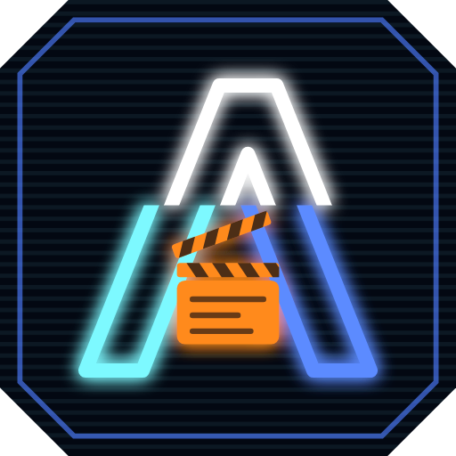

<p align="center">
  
</p>

<h1 align="center">Aria Studio</h1>

Un studio de génération d'images et de vidéos **100 % local**, piloté depuis le navigateur. Tu composes ton idée
en français au Scénario, un LLM local t'aide à en faire un prompt fidèle, et ta carte graphique tourne exactement ce
prompt : rien ne part dans le cloud.

Sous le capot : [FastAPI](https://fastapi.tiangolo.com/) pour l'interface, [ComfyUI](https://github.com/comfyanonymous/ComfyUI)
pour les images et les vidéos, [llama.cpp](https://github.com/ggml-org/llama.cpp) pour le LLM.

> **Testée sur une seule machine.** Aria n'a été essayée que sous Windows 11, avec une RTX 4080 SUPER 16 Go et 64 Go de RAM.
> Les retours sur d'autres cartes sont les bienvenus (onglet *Issues*).

## Ce que ça fait

- **Scénario** : la seule place où le LLM écrit. Tu choisis Image, Clip ou Séquence et le modèle cible, puis tu
  remplis ce que tu veux :
  - **Départ** : *Depuis un texte* (aucune image), *Mélanger des images* (jusqu'à 10, pour une nouvelle scène) ou
    *Redessiner une image* (une seule, refaite plus ou moins fort) ; ou bien le rush à animer, l'image à retoucher ou
    le personnage d'une séquence. Le LLM voit les images quand il écrit.
  - **Sujet** (facultatif), **Décor et ambiance**, **Mise en scène** : des listes à cliquer, assemblées mot pour mot.
  - **Histoire** (séquence) : le synopsis, les contraintes et les plans ; le LLM écrit le prompt de chaque plan.
  - **Libre** : un chat où le LLM te pose les questions qui manquent (avec des réponses à cliquer), tient une fiche
    de ce qu'il a compris, puis écrit le prompt avec toi et l'ajuste.

  Le prompt final, toujours visible et modifiable, part vers le Plateau ou le Montage.
- **Plateau** : il tourne ce prompt tel quel, avec ses réglages (modèle, format, LoRA, références, redessiner une image).
- **Retouche** : retoucher un rush au pinceau (avec ou sans masque ; le Scénario peut écrire la consigne en voyant
  l'image) ou l'agrandir (avec des raccourcis de format), avec seed, nombre de variantes et « Ranger dans ». Le résultat se
  compare à l'original avec un curseur ou côte à côte, et on peut repartir de lui. Les Rushes, l'import et le
  glisser-déposer sont dans l'onglet.
- **Dossiers** : les Rushes (images) et les Bobines (clips) ont chacun leurs dossiers.
- **Montage** : des clips vidéo avec le son (MiniMax H3), en animant un rush ou depuis le texte, et les séquences :
  il tourne les plans écrits au Scénario, avec la voix de référence de ta bibliothèque, puis assemble le film.
- **Casting** : des bancs pour comparer les modèles d'image et les LLM sur les mêmes idées, et choisir tes favoris.
- **Réglages** : par LLM, par modèle et par checkpoint, avec un bouton *Optimiser* qui part des recommandations
  officielles et de ta carte. Le moteur de chaque LLM (llama.cpp officiel ou PrismML pour les GGUF ternaires, Bonsai 2
  et ses dérivés) se choisit tout seul d'après le fichier, et peut s'imposer à la main. La réflexion des LLM est
  activée par défaut : l'écriture est plus lente, mais plus soignée. Elle se coupe LLM par LLM ; les courtes
  traductions et les questions du chat Libre s'en passent toujours.
- **Vision des LLM** : avec son projecteur d'images (`mmproj`, livré avec Bonsai 2 et valable pour ses dérivés), le LLM
  voit l'image qu'il anime, qu'il retouche ou qu'il prend en référence avant d'écrire. Sans projecteur, il lit le
  prompt qui a créé l'image. Ce que tu fixes reste intouchable : il ne remplit que ce que tu as laissé ouvert.
- **Modèles**, en cinq sous-onglets :
  - **Rechercher** : modèles image, modèles vidéo, LoRA ou LLM, sur Civitai et Hugging Face. Seuls les modèles qui
    vont dans un workflow d'Aria sont montrés, leur dossier est choisi pour toi, et ce que tu as déjà porte
    « installé ✓ ».
  - **Ma collection** : ce que tu as, d'où ça vient, et quels workflows l'utilisent. « Retrouver les sources »
    retrouve la page Civitai d'un fichier déposé à la main, grâce à son empreinte SHA-256 et seulement sur un clic.
  - **Texte → image**, **Image → image**, **Vidéo** : les workflows de chaque usage, avec leur favori, leurs
    checkpoints, leurs LoRA, le LLM qui écrit pour chacun (le Scénario le prend tout seul), et un bouton pour
    télécharger ce qui leur manque. Quand l'auteur d'un modèle publie un LLM
    entraîné pour lui écrire ses prompts (le « prompt enhancer » de Qwen-Image 2.1, par exemple), Aria le propose
    🎯 : choisi au Scénario, il écrit avec sa propre consigne officielle. Les autres LLM reçoivent les règles du modèle cible,
    tirées de ses guides officiels.
- **✕ Annuler** : une création, un clip ou une séquence en cours s'arrête d'un clic, où qu'elle en soit ; ce qui
  est déjà produit reste.
- **Garde-VRAM** : une génération attend que les autres applis rendent la carte graphique au lieu de planter.

## Configuration requise

- **Windows 11, 64 bits.** Windows 10 n'a pas été vérifié.
- **Une carte NVIDIA** avec un pilote de la branche **580 ou plus récente** (les moteurs sont compilés pour CUDA 13).
  Testé seulement sur 16 Go de VRAM : les minimums par carte ne sont pas encore mesurés.
- **De la place disque**, selon ce que tu installes :

| Pack | Pour | Taille |
|---|---|---|
| Images (conseillé) | Créer depuis une idée ou des références | 16 Go |
| Réécriture des prompts (conseillé) | Le LLM qui transforme ton idée en prompt | 8 Go |
| Retouche avancée | Retouche plus précise, avec masque | 29 Go |
| Vidéo | Clips et séquences avec voix | 39 Go |
| Bonsai 2 27B (facultatif) | Un second LLM, compressé en ternaire | 6 Go |

Les packs partagent certains fichiers : Images, Retouche et Vidéo ensemble font environ 84 Go. Compte en plus
environ 8 Go pour les moteurs (archives gardées pour pouvoir revenir en arrière), et 10 Go de marge que l'assistant
garde libres.

## Installation

1. Télécharge `Aria-Studio-X.Y.Z.zip` depuis la [dernière release](https://github.com/ZedjeK/Aria-Studio/releases/latest)
   avec son fichier `.sha256`, et vérifie l'empreinte :

   ```powershell
   Get-FileHash .\Aria-Studio-X.Y.Z.zip -Algorithm SHA256
   ```

2. Décompresse le zip où tu veux, puis double-clique sur `Aria-Studio.exe`. L'interface s'ouvre dans ton navigateur.
   Pour fermer Aria, clique sur **⏻ Quitter**, au bout de la barre des onglets : son serveur, ComfyUI et Llama
   s'arrêtent.
3. Le lanceur n'est pas signé : Windows SmartScreen peut afficher « Windows a protégé votre ordinateur ». Clique sur
   *Informations complémentaires*, puis sur *Exécuter quand même*.
4. Au premier lancement, l'**assistant** te guide :
   1. **Ta machine** : carte graphique, pilote, mémoire, et le dossier où iront les modèles ;
   2. **Moteurs** : ComfyUI et llama.cpp, dans les versions testées avec Aria, téléchargés depuis leur release GitHub
      officielle et vérifiés par leur SHA-256 ;
   3. **Ce que tu veux faire** : les packs à cocher, avec la place nécessaire ;
   4. **Licences** : celle de chaque modèle, à lire et accepter avant tout téléchargement ;
   5. **Téléchargement** : depuis Hugging Face, chaque fichier vérifié par son empreinte à l'arrivée ;
   6. **C'est prêt** : les modèles réglés par défaut, et une image d'essai pour vérifier que tout tourne.

   Tu peux le relancer à tout moment depuis l'onglet Réglages pour ajouter un pack.

### Tu as déjà ComfyUI ?

Dans Réglages, carte Moteurs, *Utiliser mon ComfyUI…* accepte un **ComfyUI portable** (avec `python_embeded`) d'une
version au moins égale à celle d'Aria. Aria le lance une fois pour vérifier qu'il connaît tous les nœuds dont elle
a besoin, et n'y installe rien.

## Où vont tes affaires

Tout ce qui t'appartient vit dans `%USERPROFILE%\.Aria-Studio`, qu'une mise à jour ne touche jamais :

| Dossier | Contenu |
|---|---|
| `data\` | Rushes, clips, séquences, voix, réglages, journaux |
| `modeles\` | Les modèles (ailleurs si tu l'as changé dans l'onglet Modèles) |
| `moteurs\` | ComfyUI portable et llama-server |
| `aria.yaml` | Tes choix : dossier des modèles, favoris, licences acceptées |

**Mode portable** (clé USB, disque externe…) : crée un dossier `data` à côté de `Aria-Studio.exe`, et tout restera
dans le dossier du programme (les moteurs vont alors dans `services`).

**Mettre à jour** : décompresse la nouvelle version, et lance-la. En mode portable, recopie d'abord tes dossiers
`data`, `modeles` et `services` et ton `aria.yaml` dans la nouvelle version.

## Licences des modèles

Aria ne fournit aucun modèle : chacun a sa propre licence, affichée dans l'assistant et dans l'onglet Modèles.
**C'est à toi de vérifier que ton usage la respecte.** Pour les modèles proposés par l'assistant :

| Modèle | Licence | À savoir |
|---|---|---|
| Qwen-Image 2.1 et 2.1 Edit | [Qwen Research License](https://huggingface.co/Qwen/Qwen-Image-2.1/blob/main/LICENSE) | Usage non commercial seulement |
| Qwen-Image-Edit 2511 | Apache 2.0 | Usage commercial permis ; l'encodeur de texte vient d'un dépôt à licence « other » |
| MiniMax H3 | [MiniMax H3 Community License](https://huggingface.co/MiniMaxAI/MiniMax-H3/blob/main/LICENSE) | Non autorisé dans l'Union européenne, au Royaume-Uni, en Corée du Sud et aux États-Unis ; lis les conditions commerciales ; le Turbo 8 steps n'a pas de licence déclarée |
| Ministral 3 14B, Bonsai 2 27B | Apache 2.0 | Usage commercial permis |

## Contenu et sécurité

Chaque prompt passe par le filtre **AS-18**, avant la file d'attente et juste avant d'être envoyé à ComfyUI. Un
personnage mineur est autorisé (scène de famille, manga…), mais un personnage mineur associé à un terme sensible
(nudité, sexualité, suggestif) est toujours bloqué. Le filtre ne se désactive pas : `securite/termes.yaml` peut
seulement ajouter des termes, jamais en retirer.

Aria n'écoute que sur ta machine (`127.0.0.1`). Une fois par jour, elle demande à GitHub s'il existe une nouvelle
release (option à couper dans Réglages). Elle ne télécharge rien d'elle-même : chaque téléchargement part d'un clic.

Certains modèles Civitai et Hugging Face demandent ta clé d'accès. Colle-la dans Réglages, carte **🔑 Clés
d'accès**. Elle est rangée dans le Gestionnaire d'identification Windows, chiffrée et propre à ton compte, jamais
dans un fichier d'Aria, et l'interface ne la réaffiche jamais. Un bouton la teste auprès de sa source. Les
variables d'environnement `CIVITAI_TOKEN` et `HF_TOKEN` servent si aucune clé n'est enregistrée dans Aria.

## Pour les développeurs

Il faut Python 3.11. `run.ps1` prépare le `.venv`, installe `requirements.txt` et lance le serveur sur
<http://127.0.0.1:8075> :

```powershell
.\run.ps1
```

Les tests tournent dans un dossier utilisateur jetable : ils ne touchent jamais ton `%USERPROFILE%\.Aria-Studio`
(modèles installés, réglages, créations), et leur résultat ne dépend pas de ce qui est installé :

```powershell
.venv\Scripts\python.exe tools\tester.py
```

Le banc de palier mesure la VRAM que chaque modèle demande vraiment, en simulant des cartes de 12 et 8 Go sur une
carte de 16 Go (une bonne heure de GPU, serveur d'Aria arrêté). `--ecrire` reporte ensuite les mesures dans les
fiches :

```powershell
.venv\Scripts\python.exe -m app.paliers
```

Construire la version portable (Python embarqué, dépendances du `.venv`, lanceur compilé avec le `csc.exe` de
Windows) et l'installer dans `%USERPROFILE%\.Aria-Studio`, à côté de tes affaires. Seuls les fichiers du programme
sont remplacés. Avec `--sans-installer`, elle reste dans `.build_cache\staging` pour faire le zip :

```powershell
.venv\Scripts\python.exe tools\build_portable.py
```

| Dossier | Rôle |
|---|---|
| `app\` | Le serveur : Plateau, Montage, séquences, orchestrateur des moteurs, assistant… |
| `web\` | L'interface (HTML, CSS, JavaScript, sans framework) |
| `workflows\` | Un dossier par modèle : graphe ComfyUI (`api.json`) et sa fiche (fichiers, SHA-256, licence) |
| `catalogue\` | Moteurs épinglés, LLM, packs de l'assistant |
| `casting\`, `prompt\`, `securite\` | Idées des bancs, listes du prompt, termes du filtre AS-18 |
| `tools\` | Construction de la version portable et son lanceur |

## Crédits

- [ComfyUI](https://github.com/comfyanonymous/ComfyUI), [llama.cpp](https://github.com/ggml-org/llama.cpp) et le
  [llama.cpp de PrismML](https://github.com/PrismML-Eng/llama.cpp) pour les GGUF ternaires ;
- les modèles [Qwen-Image](https://github.com/QwenLM/Qwen-Image-2.1), [MiniMax H3](https://huggingface.co/MiniMaxAI/MiniMax-H3),
  [Ministral 3](https://huggingface.co/mistralai/Ministral-3-14B-Instruct-2512) et
  [Bonsai 2](https://huggingface.co/prism-ml/Ternary-Bonsai-2-27B-gguf), avec les versions préparées pour ComfyUI
  par [Comfy-Org](https://huggingface.co/Comfy-Org) ;
- [FastAPI](https://fastapi.tiangolo.com/), [Uvicorn](https://www.uvicorn.org/), [Pillow](https://python-pillow.org/),
  [python-build-standalone](https://github.com/astral-sh/python-build-standalone).

## Licence

Le code d'Aria Studio est sous [licence MIT](LICENSE). Les moteurs et les modèles qu'il télécharge gardent leur
propre licence. Les polices de l'interface, [Space Grotesk](https://github.com/floriankarsten/space-grotesk) et
[IBM Plex Mono](https://github.com/IBM/plex), sont embarquées dans `web/polices/` sous licence SIL Open Font
License 1.1 (textes joints).
