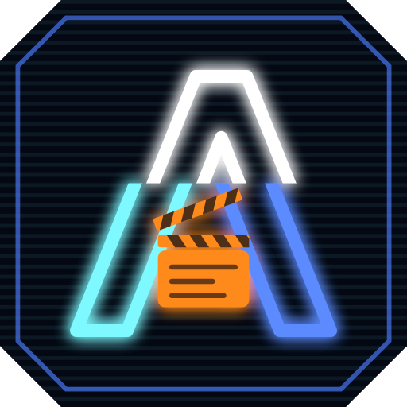

<p align="center">
  
</p>

<h1 align="center">Aria Studio</h1>

Un studio de génération d'images et de vidéos **100 % local**. Tu composes ton idée en français au Scénario, un LLM
local t'aide à en faire un prompt fidèle, et ta carte graphique tourne exactement ce prompt : rien ne part dans le
cloud, et rien n'est envoyé à l'auteur.

Aria Studio est une appli Windows en un seul exe : une fenêtre à elle (Rust, [Tauri 2](https://tauri.app/), interface
[Svelte 5](https://svelte.dev/)), sans navigateur ni Python. Elle pilote deux moteurs qu'elle installe et lance elle-même :
[ComfyUI](https://github.com/comfyanonymous/ComfyUI) pour les images et les vidéos, et
[llama.cpp](https://github.com/ggml-org/llama.cpp) pour le LLM.

> **Version 3, une réécriture complète de la 2.x** (Python). Elle relit les données d'une v2 telles quelles et peut
> s'installer par la mise à jour intégrée de la v2. Tant que la 3.0.0 n'est pas publiée, ses préversions
> `3.0.0-essai.N` servent à l'essayer : [docs/migration/ESSAI-V3.md](docs/migration/ESSAI-V3.md).
>
> **Testée sur une seule machine.** Aria n'a été essayée que sous Windows 11, avec une RTX 4080 SUPER 16 Go et 64 Go
> de RAM. Les retours sur d'autres cartes sont les bienvenus (onglet *Issues*). Ce qui n'a jamais tourné en vrai est
> listé dans [docs/migration/PARITE.md](docs/migration/PARITE.md).

## Ce que ça fait

Les pages sont rangées en trois familles dans le menu de gauche.

**Création**

- **Scénario** : la seule place où le LLM écrit. Quatre ateliers : *Image*, *Retouche*, *Clip* et *Séquence*. Tu choisis
  le modèle cible, puis tu remplis ce que tu veux :
  - **Départ** : *Depuis un texte*, *Mélanger des images* (jusqu'à 10) ou *Redessiner une image* ; ou bien le rush à
    animer, l'image à retoucher, le personnage d'une séquence. Le LLM voit les images quand il écrit, s'il a sa vision.
  - **Sujet**, **Décor et ambiance**, **Mise en scène** : des listes à cliquer, assemblées mot pour mot.
  - **✨ Écrire**, **💬 M'aider à préciser** (un chat où le LLM pose les questions qui manquent, avec des réponses à
    cliquer) et **🧭 Me guider** (des questions une à une, sans LLM).
  - **Séquence** : le fil de l'histoire, les plans, leurs répliques, découpés puis écrits plan par plan.

  Le prompt final, toujours visible et modifiable, part vers le Plateau, la Retouche ou le Montage.
- **Plateau** : il tourne ce prompt tel quel, ou réécrit ton idée avec le LLM (« Réécrire mon idée »), avec ses
  réglages (modèle, format, nombre, seed, LoRA, références, redessiner une image). Les Rushes sont dans la page.
- **Retouche** : retoucher un rush au pinceau (avec masque) ou l'agrandir, avec variantes, « Ranger dans » et un
  avant · après.
- **Montage** : des clips vidéo avec le son (MiniMax H3), en animant un rush ou depuis le texte ; les **Séquences**
  (les plans écrits au Scénario, tournés puis assemblés en film) ; la bibliothèque de **Voix** de référence ; les
  **Bobines**, qui rangent les clips comme les Rushes rangent les images.

**Préparation**

- **Modèles** : *Workflows et LLM*, *Texte → image*, *Image → image*, *Vidéo*, *Ma collection* et *Rechercher*
  (Civitai et Hugging Face, filtrés sur ce qui va dans un workflow d'Aria). Téléchargements avec reprise et empreinte
  vérifiée, corbeille de tous les modèles, steps à valider d'un checkpoint, mots déclencheurs et force des LoRA.
- **Casting** : comparer des modèles d'image, de vidéo et des LLM sur les mêmes idées, à l'aveugle, noter, choisir ses
  favoris.
- **Réglages** : *Moteurs* (carte graphique, installation, « Revenir » à la version précédente, « Libérer la carte
  graphique »), *LLM*, *Modèles image et vidéo*, *Emplacements et clés*, *Sécurité* et *Claude (MCP)*. « Recommander »
  et « Adapter à ma machine » proposent des valeurs, que tu confirmes une à une.

**Appli**

- **Journal** : les 500 dernières opérations d'Aria sur tes affaires.
- **Paramètres** : démarrage avec Windows, installation, mises à jour, notifications, fond animé.

**Le LLM, en plus** (nouveautés de la v3, pas encore essayées avec un vrai LLM) :

- chaque prompt qu'il écrit est contrôlé (langue, longueur, texte cité) et redemandé une fois s'il manque son but ; s'il
  tombe en panne, ton idée part telle quelle au lieu d'un échec ;
- il propose trois directions à partir d'une envie vague ;
- il vérifie une image d'après ce qui était demandé, et choisit les meilleures d'un lot ;
- il explique une erreur (« 🩺 Expliquer ») : d'abord une base de causes connues, sans LLM, puis le LLM pour le reste.

**✕ Annuler** arrête une création, un clip ou une séquence en cours ; ce qui est déjà produit reste. Un seul moteur tient
la carte graphique à la fois, et un moteur attend que les autres applis la rendent plutôt que de planter.

## Configuration requise

- **Windows 11, 64 bits**, avec WebView2 (livré avec Windows 11). Windows 10 n'a pas été vérifié ; son `tar` ne lit pas
  l'archive de ComfyUI (format 7z, LZMA) : il y faut **7-Zip**, qu'Aria utilise s'il est installé et qu'elle demande
  avant tout téléchargement sinon.
- **Une carte NVIDIA** avec un pilote de la branche **580 ou plus récente** (les moteurs sont compilés pour CUDA 13).
  Testé seulement sur 16 Go de VRAM : les minimums par carte ne sont pas encore mesurés.
- **De la place disque** : l'assistant la calcule avant chaque téléchargement, d'après les fichiers de chaque pack
  (Images, Vidéo, Réécriture des prompts) et garde 10 Go de marge. Compte aussi quelques Go pour les moteurs.

## Installation

1. Télécharge `Aria-Studio-X.Y.Z.zip` depuis la [dernière release](https://github.com/ZedjeK/Aria-Studio/releases/latest)
   avec son fichier `.sha256`, et vérifie l'empreinte :

   ```powershell
   Get-FileHash .\Aria-Studio-X.Y.Z.zip -Algorithm SHA256
   ```

   L'empreinte prouve que le zip est intact, pas d'où il vient. Pour cela, le zip porte une attestation de provenance
   de GitHub (avec `gh` connecté) :

   ```powershell
   gh attestation verify .\Aria-Studio-X.Y.Z.zip --repo ZedjeK/Aria-Studio
   ```

   Elle prouve que le zip sort du workflow de ce dépôt, sur le tag de la version.

2. **Décompresse d'abord le zip en entier** (clic droit, « Extraire tout »), dans un dossier de ton choix, puis
   double-clique sur `Aria-Studio.exe`. Ne le lance pas depuis l'aperçu du zip dans l'Explorateur : l'exe y est seul,
   sans `fichiers.txt`, `LICENCES-TIERS.txt` ni `BUILDINFO.txt` à côté de lui. Il ne peut alors ni te proposer de
   s'installer, ni copier ce qui doit l'être. Une fenêtre te propose :
   - **Installer** : le programme est rangé dans `%USERPROFILE%\.Aria-Studio\programme`, à côté de tes données ; la
     version d'avant est gardée dans `sauvegardes\versions\`, puis Aria se lance depuis là. Une case crée un raccourci
     sur ton Bureau (décochée d'office ; si un raccourci existe déjà, la case propose de le mettre à jour). Le dossier
     du zip reste tel quel : tu peux le supprimer ensuite ;
   - **Lancer sans installer** : Aria tourne depuis le dossier du zip, rien n'est copié.

   « Ne plus me proposer l'installation » coupe la question ; elle se réactive dans Paramètres → Installation. Avec
   `Aria-Studio.exe --portable`, ou un dossier `data` à côté de l'exe (mode portable), la fenêtre ne s'ouvre pas.
3. L'exe n'est pas signé : Windows SmartScreen peut afficher « Windows a protégé votre ordinateur ». Clique sur
   *Informations complémentaires*, puis sur *Exécuter quand même*.
4. Au premier lancement, l'**assistant** te guide :
   1. **Ta machine** : carte graphique, pilote, mémoire ;
   2. **Moteurs** : ComfyUI et llama.cpp, dans les versions testées avec Aria, téléchargés depuis leur release GitHub
      officielle et vérifiés par leur SHA-256 ;
   3. **Ce que tu veux faire** : les packs à cocher, avec la place nécessaire ;
   4. **Licences** : celle de chaque modèle, à lire et accepter avant tout téléchargement ;
   5. **Téléchargement** : depuis Hugging Face, chaque fichier vérifié par son empreinte à l'arrivée ;
   6. **C'est prêt** : les modèles réglés par défaut, et une image d'essai pour vérifier que tout tourne.

   « Plus tard » le ferme ; Réglages → Moteurs, « 🧭 Relancer l'assistant », le rouvre. Le dossier des modèles se change
   dans Réglages → Emplacements et clés.

### Tu as une version 2 ?

La mise à jour intégrée de la v2 (son bouton « Installer ») sait installer la v3 : elle garde la v2
entière dans `programme.precedent\`, et la v3 relit tes réglages, ton journal et tes données de `%USERPROFILE%\.Aria-Studio`
telles quelles. Pour revenir à la v2 : quitte la v3 et lance `programme.precedent\Aria-Studio.exe`. Ce pont n'a été
vérifié que par des tests et un faux GitHub local (`tools\essai-pont-v2.ps1`), pas sur une vraie v2 : voir « Limites à
connaître ».

### Tu as déjà ComfyUI ?

Dans Réglages → Moteurs, *Utiliser mon ComfyUI…* accepte un **ComfyUI portable** (avec `python_embeded`) d'une version
au moins égale à celle d'Aria, **sur un disque de ce PC** : un dossier sur le réseau (`\\serveur\partage`, ou un lecteur
réseau) est refusé, car Aria lance le `python.exe` de ce dossier. Aria le lance une fois pour vérifier qu'il connaît tous
les nœuds dont elle a besoin, et n'y installe rien. Elle le lance avec ses propres dossiers de travail (dans
`cache\comfyui\`) : ses images et vidéos de départ et ses résultats ne passent pas par les dossiers `input` et
`output` de ton ComfyUI.

### L'icône près de l'horloge

Aria reste dans la zone de notification : la croix de la fenêtre la range dans l'icône, **Quitter** l'arrête vraiment
(et arrête ComfyUI et llama-server). Un clic droit ouvre un menu aux couleurs d'Aria : *Ouvrir*, *État* (ComfyUI, LLM,
VRAM utilisée, dernière erreur), *Voir la mise à jour* quand il y en a une, *Agir sans ouvrir* (annuler la génération en
cours, libérer la carte graphique), *Aller à* une page, *Démarrer avec Windows* et *Quitter*. L'icône est délavée au
repos, pleine quand un moteur tourne, avec une seule pastille : **orange**, un échec à regarder ; **cyan**, Aria agit ;
**bleue**, une mise à jour est disponible.

Relancer l'exe quand Aria tourne déjà ramène sa fenêtre au lieu d'en ouvrir une seconde.

**Démarrer avec Windows** (dans ce menu, ou dans Paramètres → Démarrage) est décoché d'office. Coché, Windows lance l'exe
à l'ouverture de ta session, sans ouvrir la fenêtre (`--silencieux`) : seule l'icône apparaît. Il écrit une valeur
« Aria Studio » sous la clé `Run` de ton compte Windows, que décocher retire.

**Notifications** : quand une image, une retouche, un clip, une séquence ou un casting se termine, Windows te le dit si la
fenêtre d'Aria n'est pas devant toi (Paramètres → Notifications). Elle porte l'en-tête « Windows PowerShell » : Windows ne
connaît pas Aria.

### Piloter Aria depuis Claude (MCP)

L'exe est aussi un serveur MCP : `Aria-Studio.exe --mcp`. Claude Code peut voir l'état d'Aria, écrire un prompt avec ton
LLM local, lancer un rendu d'image et le suivre, et lire la fiche d'une image. Rien ne supprime, ne déplace, ne change un
réglage ni n'installe, et le filtre de protection des mineurs s'applique comme dans l'interface. Réglages → Claude (MCP)
donne la commande `claude mcp add` toute prête, ou le bloc à ajouter sous `mcpServers`. Aria doit être lancée : le relais
parle à un canal local d'Aria (un port de `127.0.0.1` choisi par Windows et un jeton neuf à chaque lancement, dans
`cache\session.json`, effacé à la sortie).

## Où vont tes affaires

Tout ce qui t'appartient vit dans `%USERPROFILE%\.Aria-Studio`, qu'une mise à jour ne touche jamais. Aria n'écrit rien dans
`%APPDATA%`, `%LOCALAPPDATA%` ni `%TEMP%`.

| Dossier ou fichier | Contenu |
|---|---|
| `reglages.json` | Tous tes réglages et choix : dossier des modèles, favoris, licences acceptées, fond, notifications, réglages des LLM et des workflows… |
| `journal.json` | Les 500 dernières opérations d'Aria sur tes affaires (téléchargements, moteurs, corbeilles, réglages), visibles dans la page Journal |
| `sauvegardes\` | Une copie de `reglages.json` avant chaque changement (les 20 dernières), et `versions\` : la version d'avant du programme |
| `secrets\` | Tes clés d'accès Civitai et Hugging Face, chiffrées (voir « Limites à connaître ») |
| `cache\` | Ce qui se recalcule (empreintes des modèles, listes annoncées par ComfyUI), le cache de l'interface, les dossiers de travail de ComfyUI (`cache\comfyui\`) et la mise à jour en cours : l'effacer ne perd rien |
| `data\` | Rushes, clips, séquences, voix, personnages, castings |
| `modeles\` | Les modèles (ailleurs si tu l'as changé dans Réglages → Emplacements et clés) |
| `moteurs\` | ComfyUI portable et llama-server |
| `programme\` | Le programme, si tu l'as installé (la version d'avant d'une v2 reste dans `programme.precedent\`) |

**Mode portable** (clé USB, disque externe…) : crée un dossier `data` à côté de `Aria-Studio.exe`, et tout restera dans le
dossier du programme (les moteurs vont alors dans `services`).

**Mettre à jour** : si le réglage est coché (Paramètres → Mises à jour), Aria demande à GitHub au lancement s'il existe une
nouvelle version ; le bandeau « une mise à jour est disponible » et « Voir la mise à jour » proposent de l'installer. Tu
peux aussi cliquer sur « Vérifier maintenant ». Après ta confirmation, Aria télécharge le zip de la dernière release (et
d'elle seule, sur `github.com`), vérifie sa taille et son empreinte SHA-256, remplace son exe là où il est et garde la
version précédente dans `sauvegardes\versions\`, puis redémarre. Une préversion (`-essai.N`) n'est jamais proposée.

**Désinstaller** : quitte Aria, puis supprime le dossier `%USERPROFILE%\.Aria-Studio\programme` (et `programme.precedent`)
et le raccourci du Bureau. Tes données restent dans `%USERPROFILE%\.Aria-Studio` ; supprime ce dossier entier pour tout
effacer, modèles compris. Si « Démarrer avec Windows » était coché, décoche-le d'abord (Paramètres → Démarrage).

## Licences des modèles

Aria ne fournit aucun modèle : chacun a sa propre licence, affichée dans l'assistant et dans Modèles. **C'est à toi de
vérifier que ton usage la respecte.** Pour les modèles proposés par l'assistant :

| Modèle | Licence | À savoir |
|---|---|---|
| Qwen-Image 2.1 et 2.1 Edit | [Qwen Research License](https://huggingface.co/Qwen/Qwen-Image-2.1/blob/main/LICENSE) | Usage non commercial seulement |
| MiniMax H3 | [MiniMax H3 Community License](https://huggingface.co/MiniMaxAI/MiniMax-H3/blob/main/LICENSE) | Non autorisé dans l'Union européenne, au Royaume-Uni, en Corée du Sud et aux États-Unis ; lis les conditions commerciales ; le Turbo 8 steps n'a pas de licence déclarée |
| Bonsai 2 27B | Apache 2.0 | Usage commercial permis |

Krea 2 Turbo (Krea 2 Community License) est aussi un workflow d'Aria, mais pas dans l'assistant. La licence de chaque modèle
et de chaque LLM proposé est dans [LICENCES-TIERS.txt](LICENCES-TIERS.txt).

## Contenu et sécurité

Chaque prompt passe par le filtre **AS-18**, avant la file d'attente et juste avant d'être envoyé à ComfyUI. Un personnage
mineur est autorisé (scène de famille, manga…), mais un personnage mineur associé à un terme sensible (nudité, sexualité,
suggestif) est toujours bloqué. Le filtre ne se désactive pas.

Ses listes se voient dans Réglages → Sécurité. Le socle (`securite/socle.yaml`) est embarqué dans l'exe : tu peux le lire,
pas le modifier ni en retirer un terme. Tes ajouts s'y additionnent et comptent dès la génération suivante ; ils sont rangés
avec tes autres réglages (`reglages.json`, section `securite`). « Essayer une phrase » montre ce que le filtre en fait, et
les phrases témoins signalent une liste qui ne bloque plus ce qu'elle doit, ou qui bloque à tort. Si le socle manque ou
est illisible, Aria refuse de générer.

Certains modèles Civitai et Hugging Face demandent ta clé d'accès. Colle-la dans Réglages → Emplacements et clés, panneau
« 🔑 Clés d'accès ». Elle est chiffrée avec la protection des données de Windows (DPAPI), propre à ton compte, et rangée
dans `secrets\` : jamais en clair dans un fichier d'Aria, et l'interface ne la réaffiche jamais. Un bouton la teste auprès
de sa source. Si tu as une v2, ses clés du Gestionnaire d'identification de Windows sont recopiées au lancement (l'entrée
d'origine reste en place) ; les variables d'environnement `CIVITAI_TOKEN` et `HF_TOKEN` servent si aucune clé n'est
enregistrée dans Aria.

**Réseau** : ComfyUI et llama-server n'écoutent que sur `127.0.0.1` (ports 8195 et 8095). L'interface n'a plus de serveur web :
elle parle à l'exe par le canal interne de Tauri. Aria ne se connecte qu'à GitHub (moteurs, mises à jour), Hugging Face
(modèles) et Civitai (recherche, fiches, vignettes), et seulement à ta demande (un clic, une recherche, un téléchargement), sauf la recherche de
mise à jour au lancement, que tu peux couper. La liste complète, destination par destination, est dans [docs/FICHE.md](docs/FICHE.md).

Pour signaler une faille : voir [SECURITY.md](SECURITY.md).

## Limites à connaître

Ce qu'Aria ne fait pas, ou ne garantit pas, pour que tu ne le découvres pas par accident :

- **L'exe n'est pas signé.** La signature de code n'est pas gratuite : Windows SmartScreen affiche un avertissement au
  premier lancement, et rien ne prouve à Windows qui a fabriqué l'exe.
- **Tes clés d'accès ne sont pas protégées d'un programme de ton compte.** Le chiffrement DPAPI les protège contre
  quelqu'un qui copierait tes fichiers (une autre session Windows, un disque emporté). Il ne les protège pas d'un
  programme lancé sous ton compte Windows : celui-là peut déchiffrer `secrets\` comme Aria le fait.
- **Une mise à jour prouve son intégrité, pas sa provenance.** Aria vérifie la taille et l'empreinte SHA-256 annoncées par
  GitHub : cela prouve que le zip est celui de la release, pas que la release est légitime. Si le compte GitHub de l'auteur
  était compromis, une fausse release aurait de vraies empreintes. La provenance repose sur ce compte, sur les releases
  immuables et sur l'attestation jointe à chaque release (`gh attestation verify`, voir Installation) ; Aria, elle, ne
  vérifie pas l'attestation.
- **Le canal du MCP ne protège pas d'un programme de ton compte.** Il écoute sur `127.0.0.1` et exige un jeton, mais ce
  jeton est écrit dans `cache\session.json` : un programme lancé sous ton compte peut le lire, comme Claude le fait.
- **ComfyUI est joignable par tout programme de ta machine.** Il n'écoute que sur `127.0.0.1` et refuse les autres sites du
  navigateur, mais il n'a aucune option de clé d'accès : un programme local peut lui parler directement, sans passer par
  Aria. llama-server, lui, reçoit une clé neuve à chaque démarrage et refuse qui ne la présente pas.
- **Ce que Claude reçoit part vers ton compte Claude.** Avec le serveur MCP, l'état d'Aria, les prompts écrits et les fiches
  des images (idée, prompt, modèle, seed) passent par Claude, donc par le compte Claude que tu utilises. Les images
  elles-mêmes restent sur ton PC : Claude ne reçoit que leur chemin, mais il peut ouvrir un fichier si ses propres outils le
  lui permettent.
- **Les sauvegardes des réglages ne se restaurent pas depuis l'appli.** Aria garde les 20 dernières copies de
  `reglages.json` dans `sauvegardes\`, mais aucune page ne les restaure : il faut copier le fichier à la main.
- **La garde de la carte graphique n'a pas de bouton.** Un moteur attend que les autres applis rendent la carte graphique
  avant de démarrer, mais l'interface ne propose ni de forcer ni d'annuler cette attente.
- **Le glisser-déposer d'une image n'existe pas.** La Retouche prend ses images dans les Rushes ou par import.
- **L'icône Windows de l'exe est celle de la famille Aria** tant que l'icône propre à Aria Studio n'a pas été générée.
- **La corbeille garde la place.** Un modèle, une séquence ou un rush supprimé part à la corbeille d'Aria et se restaure ;
  la place sur le disque n'est libérée qu'avec « Vider la corbeille », qui, elle, est définitive. La corbeille des modèles
  vit dans leur dossier (`.corbeille`) : si tu changes de dossier des modèles, celle de l'ancien y reste.
- **Fermer la fenêtre ne ferme pas Aria.** Elle reste dans l'icône, et parfois un moteur et la mémoire de la carte graphique
  restent occupés, tant que tu n'as pas choisi **Quitter**.
- **La notification de fin de rendu** porte l'en-tête « Windows PowerShell » : Aria n'enregistre rien dans Windows pour
  avoir son propre nom.
- **Un ancien ComfyUI garde ses fichiers de travail.** Si tu viens de la v2 (jusqu'à la 1.3.0), `ComfyUI\input` et
  `ComfyUI\output` peuvent contenir une copie de chaque fichier envoyé et de chaque résultat ; Aria ne les efface pas pour
  toi, car certains peuvent être la dernière copie d'une création.
- **Pas encore vu en vrai.** Les fonctions qui passent par un vrai LLM (contrôle qualité, directions, vérifier, choisir,
  expliquer), la reprise des dossiers d'une v2, le pont de mise à jour depuis une v2, l'installation par un vrai clic, le
  menu de l'icône et le serveur MCP branché à Claude Code ont des tests mais n'ont pas été essayés sur un PC.
- **Testée sur une seule machine** (Windows 11, RTX 4080 SUPER 16 Go, 64 Go de RAM) : les minimums de VRAM par modèle ne
  sont pas mesurés (le banc de palier n'a jamais tourné).

## Pour les développeurs

Il faut Rust (la version est fixée par `rust-toolchain.toml` : `rustup` l'installe au premier appel de `cargo`) et Node.js
pour l'interface. Le dépôt est un espace de travail Cargo : `coeur` (la logique, testée sans fenêtre), `appli` (la fenêtre
Tauri et les appels à Windows) et `interface` (Svelte 5, TypeScript).

```powershell
.\build.ps1
```

compile l'interface puis l'exe, et l'écrit dans `.work\sortie\Aria-Studio.exe` : un seul fichier, rien à extraire au
lancement. `.\tools\version.ps1` affiche la version (elle vit à un seul endroit, `Cargo.toml`).

```powershell
.\tools\tester.ps1
```

lance, dans l'ordre : `svelte-check`, les tests de l'interface (vitest), `rustfmt`, `clippy` (les avertissements sont des
erreurs), `cargo test`, puis le contrôle de `LICENCES-TIERS.txt`. La CI (job `tests`) lance ce même script. Les tests
tournent dans des dossiers jetables : ils ne touchent jamais ton `%USERPROFILE%\.Aria-Studio`.

Le banc de palier mesure la VRAM que chaque modèle demande vraiment, en simulant des cartes de 16, 12 et 8 Go (une bonne
heure de GPU, moteurs d'Aria arrêtés) ; `--ecrire` reporte ensuite les mesures dans les fiches :

```powershell
cargo run -p aria-coeur --bin paliers --release
```

Publier une version : passer la version au nouveau numéro dans `Cargo.toml`, déposer les notes dans
`docs/releases/vX.Y.Z.md`, vérifier avec `.\tools\verifier-release.ps1 -Tag vX.Y.Z` (notes, fiche projet, licences),
fusionner, puis pousser le tag. `.github/workflows/release.yml` construit alors le zip et son `.sha256` sur Windows,
joint l'attestation de provenance et crée la release en brouillon, à relire et à publier. Un tag `vX.Y.Z-essai.N` donne
une préversion d'essai.

| Dossier | Rôle |
|---|---|
| `coeur\` | La logique d'Aria : orchestrateur des moteurs, Plateau, Montage, séquences, assistant, mises à jour, filtre AS-18, secrets… |
| `appli\` | L'exe : fenêtre, icône de notification, commandes Tauri, appels à Windows |
| `interface\` | L'interface (Svelte 5, TypeScript) |
| `workflows\` | Un dossier par modèle : graphe ComfyUI (`api.json`) et sa fiche (fichiers, SHA-256, licence) |
| `catalogue\` | Moteurs épinglés, LLM, packs de l'assistant |
| `casting\`, `prompt\`, `securite\` | Idées des castings, listes du prompt, socle et phrases témoins du filtre AS-18 |
| `tools\` | Empaquetage, icône, licences, vérification de release, protections du dépôt |
| `docs\` | La fiche projet, les notes de version, la migration depuis la v2 |

Tout ce qui est dans `catalogue\`, `workflows\`, `prompt\listes\`, `securite\` et `casting\` est embarqué dans l'exe.

## Crédits

- [ComfyUI](https://github.com/comfyanonymous/ComfyUI), [llama.cpp](https://github.com/ggml-org/llama.cpp) et le
  [llama.cpp de PrismML](https://github.com/PrismML-Eng/llama.cpp) pour les GGUF ternaires ;
- les modèles [Qwen-Image](https://github.com/QwenLM/Qwen-Image-2.1), [MiniMax H3](https://huggingface.co/MiniMaxAI/MiniMax-H3),
  [Bonsai 2](https://huggingface.co/prism-ml/Ternary-Bonsai-2-27B-gguf), avec les versions préparées pour ComfyUI par
  [Comfy-Org](https://huggingface.co/Comfy-Org) ;
- [Tauri](https://tauri.app/), [Svelte](https://svelte.dev/) et les crates et paquets npm listés dans
  [LICENCES-TIERS.txt](LICENCES-TIERS.txt).

## Licence

Le code d'Aria Studio est sous [licence MIT](LICENSE). Les moteurs et les modèles qu'il télécharge gardent leur propre
licence. Les polices de l'interface, [Space Grotesk](https://github.com/floriankarsten/space-grotesk) et
[IBM Plex Mono](https://github.com/IBM/plex), sont embarquées dans l'exe sous licence SIL Open Font License 1.1 ; tous les
composants tiers embarqués, avec leur licence, sont dans [LICENCES-TIERS.txt](LICENCES-TIERS.txt), joint au zip.
